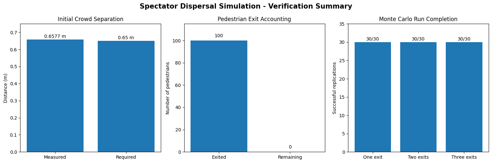

# Agent-Based Simulation of Spectator Dispersal after the Kandy Esala Perahera

An interactive agent-based pedestrian simulation investigating how uncertain spectator crowd sizes and exit availability influence dispersal time and pedestrian congestion in a hypothetical environment.

**[Live Demo](https://sashanka2001.github.io/spectator-dispersal-simulator/)** · [](https://colab.research.google.com/drive/1RYV0lGvVD7e03OvkxBqfnaaH3U2t3OXF?usp=sharing)


## The problem

Large public gatherings, such as the Kandy Esala Perahera, can result in substantial pedestrian crowds when spectators leave the event. The number of people dispersing and the availability of exit routes may influence how quickly the crowd clears and where congestion develops.

This project investigates the following research question:

**How do uncertain spectator crowd sizes and the availability of additional exit routes affect crowd dispersal time and pedestrian congestion after the Kandy Esala Perahera?**

An agent-based simulation is developed to represent individual pedestrian movement within a simplified environment. Different crowd sizes and exit configurations are tested to examine their influence on dispersal performance.

## Quick start

**Notebook:** Click the *Open in Colab* badge above. Select *Runtime → Run all* to execute the notebook. The notebook uses Python and the packages listed in `requirements.txt`.

**Web demo:** Open the [live demo](https://sashanka2001.github.io/spectator-dispersal-simulator/), or download this repository and double-click `docs/index.html` to run it locally.

**Run locally (optional):**

```bash
pip install -r requirements.txt
jupyter notebook notebook/spectator-dispersal-simulator.ipynb
```

## Using the demo

The web demo allows users to select a crowd size between 50 and 500 pedestrians, choose one, two or three exits, and adjust the walking-speed multiplier. The simulation provides a live visualisation of pedestrian movement and displays T95, clearance time, peak local density and exit utilisation.

Full instructions: [USER_GUIDE.md](USER_GUIDE.md).

## Model and mathematics

The simulation uses an agent-based approach inspired by the Social Force Model. Each pedestrian is represented as an individual agent with a position, velocity, desired walking speed and radius. Movement is influenced by the desired direction towards an exit, repulsive interactions with other pedestrians and boundary repulsion.

The model uses acceleration-based movement with a time step of 0.05 seconds. Velocity and position are updated using an explicit Euler scheme, subject to maximum speed and acceleration limits.

The environment is represented by a hypothetical 40 m × 20 m rectangular area. Full mathematical descriptions, assumptions, parameters and equations are provided in [THEORY.md](THEORY.md).

## Verification

The implementation includes checks for pedestrian counts, position boundaries, minimum initial separation, finite numerical values, exit status consistency, exit utilisation and density calculations.

Monte Carlo verification uses repeated simulations with controlled random seeds. Paired random seeds are used when comparing different exit configurations to support fair comparisons.

The verification procedures and experimental checks are documented in the notebook.



## Concepts applied

This project applies the following modelling and numerical concepts:

- **Agent-based modelling:** represents individual pedestrians as autonomous agents.
- **Social-force-inspired modelling:** represents desired movement and repulsive interactions.
- **Numerical integration:** uses explicit Euler updates to calculate pedestrian movement over time.
- **Stochastic modelling:** generates synthetic pedestrian positions and desired walking speeds using seeded random numbers.
- **Monte Carlo simulation:** performs repeated runs to examine variability in dispersal outcomes.
- **Statistical analysis:** uses means, standard deviations, confidence intervals and paired comparisons to analyse simulation results.
- **Model verification:** uses assertions and consistency checks to examine implementation correctness.

## Results

The experiments indicate that additional exit routes reduce average dispersal time and peak local density under the simulated conditions.

In the uncertain crowd-size experiment, 30 crowd sizes were sampled, ranging from 132 to 449 pedestrians. Each crowd-size sample was evaluated using all three exit configurations.

| Exit configuration | Mean T95 (s) | Mean peak density (persons/m²) |
| --- | ---: | ---: |
| One exit | 40.095 | 2.158 |
| Two exits | 37.170 | 1.558 |
| Three exits | 36.385 | 1.300 |

The three-exit configuration produced the lowest mean T95 and peak local density in this experiment. These results describe the simulated scenarios and should not be interpreted as measured outcomes from the actual event.

## Limitations and future work

- The simulation uses a hypothetical rectangular environment rather than the actual street layout of Kandy.
- Initial crowd positions and desired walking speeds are generated using synthetic values because measured pedestrian data are unavailable.
- Individual behaviour is simplified, without fully representing group movement, route choices, obstacles, vehicles or emergency responses.
- Future work could incorporate real street geometry, observed pedestrian data, model calibration, group behaviour and additional sensitivity analysis.

## Key references

The theoretical background and modelling methods are supported by the sources listed in [REFERENCES.md](REFERENCES.md).

## AI assistance

AI coding and writing assistants were used to support development, debugging and documentation. The implementation and outputs were reviewed and tested by the author. A detailed record of AI assistance is maintained separately.

## Licence and credits

The project code is released under the [MIT Licence](LICENSE).

The simulation uses synthetic pedestrian information and assumed model parameters. No external pedestrian dataset is included.
