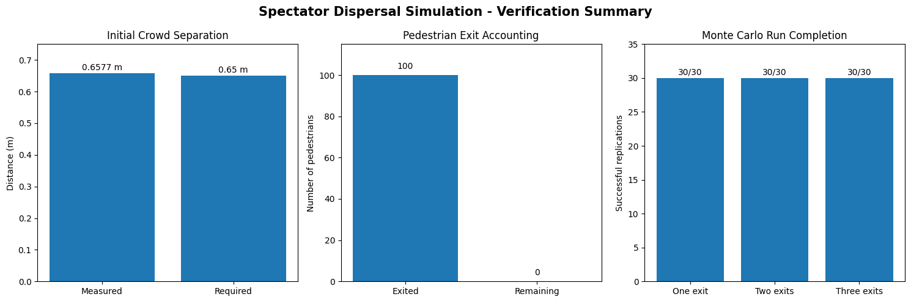

# Theory and Mathematics

## 1. Problem Formulation

This project investigates pedestrian dispersal after a large public gathering, using the Kandy Esala Perahera as its motivating context. The model examines how the initial number of pedestrians and the availability of exit routes influence the time required for a crowd to disperse and the level of local pedestrian congestion.

The system is represented as a two-dimensional rectangular environment measuring 40 m × 20 m. Individual pedestrians are modelled as autonomous agents with positions, velocities, desired walking speeds and physical radii. Pedestrians begin within a smaller spectator gathering region and move towards available exits positioned along the right boundary.

Three exit configurations are considered:

- One exit: an opening between 8 m and 12 m.
- Two exits: openings between 4 m and 8 m, and between 12 m and 16 m.
- Three exits: openings between 2 m and 6 m, between 8 m and 12 m, and between 14 m and 18 m.

The model uses a simplified approach inspired by the Social Force Model. Each pedestrian's movement is influenced by the desired direction towards the nearest exit, repulsive interactions with other pedestrians and repulsion from environmental boundaries.

The main research question is:

**How do uncertain spectator crowd sizes and the availability of additional exit routes affect crowd dispersal time and pedestrian congestion after the Kandy Esala Perahera?**

The following quantities are used to evaluate the simulation:

- **T95:** The time at which at least 95% of the pedestrians have exited.
- **Total clearance time:** The time at which all pedestrians have exited.
- **Peak local density:** The highest pedestrian density recorded in any 2 m × 2 m grid cell during the simulation.

The model is intended to compare hypothetical scenarios rather than predict actual crowd movement at the event.

## 2. Assumptions

The following assumptions are used to simplify the model and make the simulation computationally manageable.

1. **Fixed environment:** The simulated area is a rectangular region measuring 40 m × 20 m. The environment does not change during a simulation.

2. **Individual pedestrian agents:** Each pedestrian is represented as a circular agent with a radius of 0.3 m. Pedestrians have individual positions, velocities and desired walking speeds.

3. **Initial pedestrian distribution:** Pedestrians are randomly placed within the smaller spectator region, using the position limits defined in the implementation. A minimum initial separation of 0.65 m is maintained between different pedestrians.

4. **Walking-speed variation:** Each pedestrian receives a desired walking speed sampled independently from a uniform distribution between 0.8 m/s and 1.6 m/s.

5. **Initial velocity:** All pedestrians begin with zero velocity.

6. **Exit selection:** Each active pedestrian moves towards the centre of the nearest available exit, selected using the Euclidean distance from the pedestrian's current position.

7. **Pedestrian interaction:** Nearby pedestrians influence one another through an exponential repulsive interaction. This is a simplified representation of personal-space effects.

8. **Boundary interaction:** The left, upper and lower boundaries repel pedestrians. The right boundary also repels pedestrians except at the available exit openings.

9. **Exit condition:** A pedestrian is considered to have exited when their updated horizontal position reaches or crosses the right boundary and their vertical position lies within an available exit opening.

10. **Synthetic input data:** Initial positions and walking speeds are generated using assumed values. They are not measured data from the actual Kandy Esala Perahera.

11. **Uncertain crowd-size generation:** The uncertainty experiment generates 30 crowd sizes using a triangular distribution with a minimum of 100, a most likely value of 300 and a maximum of 500 pedestrians. The generated values are rounded to whole pedestrians.

12. **Simplified behaviour:** Pedestrians do not form groups or make complex decisions. The model does not include family relationships, obstacles, vehicles, emergency responses or individual route preferences.

These assumptions provide a controlled environment for comparing pedestrian dispersal under different crowd sizes and exit configurations.

## 3. Model Equations

### 3.1 Pedestrian State Representation

Each pedestrian i is represented by a position vector and a velocity vector:

$$
\mathbf{x}_i(t)=
\begin{bmatrix}
x_i(t)\\
y_i(t)
\end{bmatrix}
$$

$$
\mathbf{v}_i(t)=
\begin{bmatrix}
v_{x,i}(t)\\
v_{y,i}(t)
\end{bmatrix}
$$

where position is measured in metres (m) and velocity is measured in metres per second (m/s).

Each pedestrian also has an individual desired walking speed $v_i^0$ and radius $r_i$.

### 3.2 Desired Movement Towards an Exit

Each pedestrian selects the nearest available exit based on the Euclidean distance to the centre of each exit.

For an exit with vertical limits $y_{\min,j}$ and $y_{\max,j}$, its centre is:

$$
\mathbf{g}_j=
\begin{bmatrix}
40\\
(y_{\min,j}+y_{\max,j})/2
\end{bmatrix}
$$

Let $j(i)$ represent the exit selected by pedestrian $i$. The desired direction is calculated as:

$$
\mathbf{e}_i=
\frac{\mathbf{g}_{j(i)}-\mathbf{x}_i}
{\|\mathbf{g}_{j(i)}-\mathbf{x}_i\|}
$$

The desired velocity is:

$$
\mathbf{v}_i^{des}=v_i^0\mathbf{e}_i
$$

The desired acceleration is:

$$
\mathbf{a}_i^{des}=
\frac{\mathbf{v}_i^{des}-\mathbf{v}_i}{\tau}
$$

where $\tau$ is the relaxation time, set to 0.5 seconds. This term represents the tendency of a pedestrian to adjust their current velocity towards the desired velocity.

### 3.3 Pedestrian Repulsion

Pedestrian interactions are represented through an exponential repulsive acceleration. For pedestrians i and j, the relative position is:

$$
\mathbf{d}_{ij}=\mathbf{x}_i-\mathbf{x}_j
$$

The distance between them is:

$$
d_{ij}=\|\mathbf{d}_{ij}\|
$$

Their combined radius is:

$$
R_{ij}=r_i+r_j
$$

The interaction strength is calculated as:

$$
f_{ij}=A\exp\left(\frac{R_{ij}-d_{ij}}{B}\right)
$$

The resulting pedestrian interaction acceleration is:

$$
\mathbf{a}_i^{ped}=
\sum_{j\ne i}
f_{ij}\frac{\mathbf{d}_{ij}}{d_{ij}}
$$

where A = 2.0 m/s² and B = 0.5 m are assumed interaction parameters. The summation excludes self-interaction. The interaction becomes stronger as the distance between pedestrians decreases.

### 3.4 Boundary Repulsion

Environmental boundaries influence pedestrian movement through exponential repulsive terms.

For a pedestrian with radius $r_i$, the interaction strength associated with a wall at distance $d_{iw}$ follows:

$$
f_{iw}=A_w\exp\left(\frac{r_i-d_{iw}}{B_w}\right)
$$

where:

- $A_w=2.0\text{ m/s}^2$ is the wall interaction acceleration coefficient.
- $B_w=0.5\text{ m}$ is the wall interaction decay parameter.
- $d_{iw}$ is the distance from the pedestrian to the relevant wall.

The wall interaction acceleration is obtained by combining the repulsive contributions:

$$
\mathbf{a}_i^{wall}
=
\sum_w f_{iw}\mathbf{n}_{iw}
$$

where $\mathbf{n}_{iw}$ is a unit direction pointing away from the relevant wall.

The right boundary applies repulsion only to pedestrians outside all available exit openings. This allows pedestrians to move through the designated exits.

### 3.5 Total Acceleration and Movement Limits

The total acceleration is calculated by combining desired movement, pedestrian interactions and boundary interactions:

$$
\mathbf{a}_i=
\mathbf{a}_i^{des}
+\mathbf{a}_i^{ped}
+\mathbf{a}_i^{wall}
$$

The acceleration magnitude is limited to a maximum of 4.0 m/s². The implementation scales the acceleration vector when its magnitude exceeds this limit:

$$
\mathbf{a}_i^{lim}=
\mathbf{a}_i
\min\left(
1,\frac{a_{\max}}{\|\mathbf{a}_i\|}
\right)
$$

where $a_{\max}=4.0\text{ m/s}^2$.

The pedestrian's updated velocity is also limited to a maximum speed of 2.0 m/s.

### 3.6 Numerical Integration

The model uses an explicit Euler time-stepping approach with a fixed time step:

$$
\Delta t=0.05\text{ s}
$$

Velocity is updated first:

$$
\mathbf{v}_i(t+\Delta t)=
\mathbf{v}_i(t)+
\mathbf{a}_i^{lim}(t)\Delta t
$$

The updated velocity is limited to the maximum speed.

Position is then updated using the velocity at the beginning of the time step:

$$
\mathbf{x}_i(t+\Delta t)=
\mathbf{x}_i(t)+
\mathbf{v}_i(t)\Delta t
$$

This is the update order used in the implementation. The simulation runs for a maximum of 2,000 time steps, corresponding to 100 seconds, unless all pedestrians exit earlier.

### 3.7 Crowd Density and Performance Measures

The environment is divided into grid cells measuring 2 m × 2 m. Each cell therefore has an area of 4 m².

The density in grid cell k at time t is:

$$
\rho_k(t)=\frac{N_k(t)}{A_k}
$$

where $N_k(t)$ is the number of pedestrians in the cell and $A_k=4\text{ m}^2$.

Peak local density is calculated as:

$$
\rho_{\text{peak}}=\max_{k,t}\rho_k(t)
$$

The simulation also records the time at which each pedestrian exits. T95 is obtained from the time when at least 95% of the initial crowd has exited, while total clearance time is the time when the final pedestrian exits.

### 3.8 Main Parameter Table

| Symbol / Parameter | Meaning | Units | Value / Range | Source |
| ------------------ | ------- | ----- | ------------- | ------ |
| W | Environment width | m | 40 | Model setting |
| H | Environment height | m | 20 | Model setting |
| $r_i$ | Pedestrian radius | m | 0.3 | Assumed |
| $v_i^0$ | Desired walking speed | m/s | 0.8–1.6 | Assumed uniform range |
| $\tau$ | Relaxation time | s | 0.5 | Model setting |
| A | Pedestrian interaction acceleration coefficient | m/s² | 2.0 | Assumed |
| B | Pedestrian interaction decay parameter | m | 0.5 | Assumed |
| $A_w$ | Wall interaction acceleration coefficient | m/s² | 2.0 | Assumed |
| $B_w$ | Wall interaction decay parameter | m | 0.5 | Assumed |
| $\Delta t$ | Time step | s | 0.05 | Numerical setting |
| $a_{\max}$ | Maximum acceleration | m/s² | 4.0 | Numerical limit |
| $v_{\max}$ | Maximum speed | m/s | 2.0 | Numerical limit |
| $d_{\min}$ | Minimum initial separation | m | 0.65 | Initial placement rule |
| Cell dimensions | Density grid size | m × m | 2 × 2 | Measurement setting |
| Maximum steps | Simulation step limit | steps | 2,000 | Simulation setting |
| Maximum duration | Simulation time limit | s | 100 | Calculated from time step and step limit |
| Minimum crowd size | Lower triangular distribution limit | pedestrians | 100 | Uncertainty experiment |
| Most likely crowd size | Mode of triangular distribution | pedestrians | 300 | Uncertainty experiment |
| Maximum crowd size | Upper triangular distribution limit | pedestrians | 500 | Uncertainty experiment |
| Uncertainty samples | Number of sampled crowd sizes | samples | 30 | Experimental setting |

The interaction strengths $A$ and $A_w$ are assumed acceleration coefficients used in the simplified interaction calculations. They have not been calibrated against measured pedestrian data.

## 4. Numerical Method

The simulation uses an explicit Euler time-stepping method to update pedestrian velocities and positions. The fixed time step is 0.05 seconds, and the maximum number of steps is 2,000, giving a maximum simulated duration of 100 seconds.

At each time step, the following procedure is performed:

1. Identify pedestrians who have not yet exited.
2. Select the nearest available exit for each active pedestrian.
3. Calculate desired acceleration towards the selected exit.
4. Calculate repulsive interactions between active pedestrians.
5. Calculate repulsion from the environment boundaries.
6. Combine the acceleration components and limit the acceleration magnitude to 4.0 m/s².
7. Update velocities using the calculated acceleration and limit each speed to 2.0 m/s.
8. Update positions using the velocities at the beginning of the time step.
9. Check whether pedestrians have crossed an exit opening or reached a solid boundary.
10. Record pedestrian positions, exit counts, exit times and density information.

The process is repeated until all pedestrians have exited or the maximum simulation duration has been reached.

The explicit Euler method is a first-order numerical integration method. Its accuracy depends on the time step and the behaviour of the model. The acceleration and speed limits restrict extreme updates, but they do not independently prove numerical stability or convergence. A separate time-step convergence study would be required to assess how reducing the time step affects the results.

Random pedestrian positions and walking speeds are generated using NumPy random number generators with fixed seeds in the experiments. This supports reproducibility and allows corresponding exit configurations to be compared using the same initial crowd.

## 5. Independent Verification of Euler Integration

The numerical integration method was independently examined using the relaxation equation:

$$
\frac{dv}{dt}=\frac{v_d-v}{\tau}
$$

The numerical Euler solution was compared with its exact analytical solution:

$$
v(t)=v_d+(v_0-v_d)e^{-t/\tau}
$$

The experiment used a relaxation time of 0.5 s, an initial velocity of 0.0 m/s, a desired velocity of 1.2 m/s, and a final evaluation time of 2.0 s.

Four time-step sizes were examined: 0.1, 0.05, 0.025, and 0.0125 seconds.

The measured convergence order was 0.9679, which is close to the theoretical first-order convergence expected from the explicit Euler method. The absolute error decreased as the time-step size was reduced.

The convergence results are shown in [figures/euler_convergence.png](figures/euler_convergence.png).

This experiment provides an independent numerical check of the Euler integration method used in the simulation. It does not constitute validation of the complete pedestrian movement model.

## 6. Verification

Verification checks were performed to examine whether the implementation follows the defined model rules and produces valid numerical results. The checks cover pedestrian generation, movement calculations, boundary conditions, exit management, density calculations and repeated simulation experiments.

| Check | Expected | Obtained | Pass? |
| ----- | -------- | -------- | ----- |
| Pedestrian count | Requested number of agents generated | Correct number generated | Yes |
| Position and velocity dimensions | Each agent has two position and velocity components | Valid array dimensions | Yes |
| Initial position boundaries | All generated positions remain in the placement region | Boundary checks passed | Yes |
| Walking speed limits | Speeds remain between 0.8 and 1.6 m/s | Range checks passed | Yes |
| Minimum initial separation | Pairwise distances are at least 0.65 m | Approximately 0.6577 m in the recorded test | Yes |
| Finite numerical values | Positions, velocities and accelerations contain finite values | Numerical checks passed | Yes |
| Exit count consistency | Exit count does not decrease and does not exceed the initial crowd | Consistency checks passed | Yes |
| Agent status conservation | Every pedestrian is either active or exited | Status checks passed | Yes |
| Exit boundary condition | Exited pedestrians have crossed an available exit | Exit-position checks passed | Yes |
| Density calculation | Density values are finite and non-negative, with consistent pedestrian counts | Density checks passed | Yes |
| Scenario completion | All pedestrians exit in the tested scenarios | All tested scenario checks passed | Yes |
| Uncertain crowd experiment | 30 replications complete for each exit configuration | 90 successful runs, with no incomplete runs | Yes |

The recorded minimum initial pedestrian separation was approximately 0.6577 m, which satisfies the required minimum separation of 0.65 m. The uncertain crowd experiment completed 30 replications for each of the three exit configurations, producing 90 successful simulation runs.

These checks demonstrate implementation consistency under the tested conditions. They do not establish that the simplified model accurately reproduces real-world pedestrian behaviour.

## 7. Concepts Applied

| Concept | Where it is used in this project |
| ------- | ------------------------------- |
| Agent-based modelling | Represents each pedestrian as an individual agent with position, velocity, desired speed and interaction properties. |
| Particle-based simulation | Represents pedestrians as moving entities within a two-dimensional environment. |
| Social-force-inspired modelling | Combines desired movement, pedestrian repulsion and boundary repulsion to calculate acceleration. |
| Ordinary differential equation modelling | Represents changes in pedestrian position and velocity over simulation time. |
| Numerical integration | Uses explicit Euler updates to calculate pedestrian velocities and positions at each time step. |
| Random variate generation | Generates initial pedestrian positions and desired walking speeds using seeded random number generators. |
| Stochastic modelling | Represents variation in initial crowd conditions and pedestrian characteristics. |
| Monte Carlo simulation | Uses repeated simulation runs to examine variation across different initial crowds and exit configurations. |
| Statistical analysis | Calculates means, standard deviations and 95% confidence intervals for experimental outcomes. |
| Sensitivity and uncertainty analysis | Examines the effects of different crowd sizes and randomly sampled crowd-size inputs. |
| Model verification | Uses assertions and numerical checks to examine agent states, movement, exit conditions and density calculations. |

## 8. References

The academic and technical references supporting the pedestrian movement model, numerical methods and simulation approach are listed in [REFERENCES.md](REFERENCES.md).
